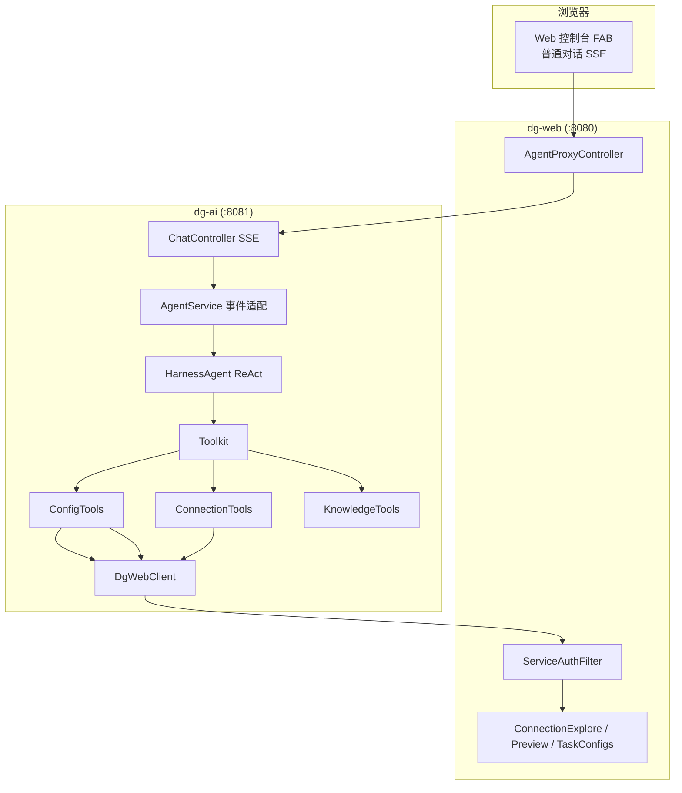

# dg-ai — Data Generator AI Agent 服务

基于 **AgentScope HarnessAgent** 的独立 HTTP 服务：**LLM-first / ReAct**。模型通过能力型 Tool 探库、拼 YAML、校验/预览并保存任务配置；**无自建 Skill / Progress / 草稿编排**。YAML 默认不对用户展示。通过 SSE 与 Web 控制台交互；Tool 经 `DgWebClient` 回调 dg-web。

**技术栈：** Java 21 · Spring Boot 3.3 · AgentScope HarnessAgent + RAG · Reactor SSE · RestTemplate · Knife4j

**架构修订：** [`docs/superpowers/specs/2026-10-14-agent-llm-first-revision.md`](../docs/superpowers/specs/2026-10-14-agent-llm-first-revision.md)

## 核心思路

| 做 | 不做 |
|---|---|
| HarnessAgent ReAct + `@Tool` 能力接口 | Skill / ProgressStore / ToolGate / 草稿分片编排 |
| 短 System Prompt 提示工作流 | 强制 phase / chatId / 特权确认通道 |
| YAML → validate / preview / save | 前端步骤条与「确认计划/保存」按钮 |
| 大配置：workspace 写文件 → 一次提交 | ConfigDraftManager 级业务合并层 |

## 架构概览



## Toolkit（仅能力工具）

| 工具集 | 主要 Tool |
|---|---|
| **ConfigTools** | `listConfigs` / `getConfig` / `deleteConfig`、`validateConfigYaml` / `saveConfig` / `previewData(fileName)`；大文件：`writeWorkspaceYaml` / `appendWorkspaceYaml` / `submitWorkspaceYaml` |
| **ConnectionTools** | `testConnection`、`listRemoteTables`、`getRemoteColumns` |
| **KnowledgeTools** | `searchDocs` 等 RAG 检索 |

连接探查工具每次传入连接参数，无会话级探针缓存。表关系由模型根据列信息自行推断。

## SSE 事件

| 事件 | 说明 |
|---|---|
| `connected` | 流已接受 |
| `text` / `thinking` | 文本与思考增量 |
| `tool_start` / `tool_end` | 工具调用 |
| `observation` | 工具结果；若 JSON 含 `ui=table` 则气泡内预览卡（可放大），其它原样文本 |
| `done` / `error` | 结束 / 错误 |

不再发送 `progress` / `preview` 等特权事件。

## 建议工作流（Prompt 提示，非强制）

1. 收集连接 → `testConnection` → `listRemoteTables` / `getRemoteColumns`
2. 与用户确认计划 → 拼完整 YAML
3. `validateConfigYaml` → `saveConfig`（或 workspace 提交）→ `previewData(fileName)`
4. 大配置：`writeWorkspaceYaml` / `appendWorkspaceYaml` → `submitWorkspaceYaml` → `previewData`
5. 编辑：`getConfig` → 修改 → 校验 → `saveConfig(fileName=…)` → `previewData`
6. 不确定时 `searchDocs`；工具失败修正后最多重试 3 次

## 模块结构（摘要）

```
dg-ai/src/main/java/com/datagenerator/ai/
├── config/          # AiAutoConfiguration、AiProperties
├── controller/      # ChatController、KnowledgeController
├── service/         # AgentService、SessionService、KnowledgeChunkService
├── tool/            # Config*、Connection*、Knowledge*
├── client/          # DgWebClient
├── prompt/          # SystemPrompt（短中文）
├── embedding/       # SimpleEmbeddingModel
└── dto/             # ChatRequest、ApiResponse、Session*
```

## 快速开始

```bash
# 依赖 dg-core 等同仓库模块
mvn -pl dg-ai -am package

# 配置 ai.model.*、ai.dg-web.base-url 后启动
java -jar dg-ai/target/dg-ai-*.jar
```

详见同目录下配置说明与 `application.yml`。
